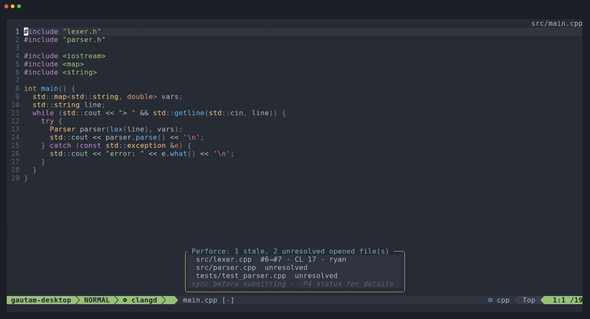

<h1 align="center">perforated.nvim</h1>

<p align="center">
  <b>Perforce (Helix Core) for Neovim — the P4V workflow, without leaving your editor.</b><br>
  Check-out on edit · gutter signs · a P4V-style client view · diff tabs · annotate · time-lapse ·
  shelve / submit / sync / resolve — all asynchronous, all in pure Lua.
</p>

<p align="center">
  <a href="https://github.com/gautambatra/perforated.nvim/actions/workflows/ci.yml"></a>
  
  
  <a href="LICENSE"></a>
</p>

<p align="center">
  
</p>

## Highlights

- 📋 **A P4V-style client view** (`:P4`): pending changelists, shelves, stale and unresolved
  files, workspace reconcile and your recent submits, with single-key actions.
- ⌨️ **P4V's shortcuts work** in the plugin's views: `Ctrl+D` diff, `Ctrl+T` history, `Ctrl+R`
  revert, `Ctrl+S` submit, `Ctrl+G` go to, `F5` refresh and more, alongside Vim-style keys.
- ✏️ **Check-out on edit**, and gutter signs against your have revision.
- 🔍 **Diff tabs** for a file or a whole changelist: pending, shelved or submitted.
- 📜 **History, annotate, current-line blame and time-lapse**, P4V-style.
- 🚀 **Shelve, submit, sync, resolve and integrate**, with long jobs you can watch and stop.
- 🔔 **A statusline** with the file's action, changelist and revision, and a notification when
  someone submits a newer revision of a file you have open.
- ⚡ **It never blocks.** Every `p4` call is asynchronous, with timeouts, cancellation and an
  offline mode. Typing never waits on the server.
- 💤 **It costs nothing outside Perforce**, and it's built for huge workspaces (100k–1M files).
  Startup takes about 0.3 ms.
- 🧩 **No dependencies.** Pure Lua plus the `p4` command-line client. Telescope, fzf-lua,
  snacks, mini.pick, lualine and icon plugins are used when you have them.

Switching from another plugin? [docs/migrating.md](docs/migrating.md) maps every command and
setting.

## Quick start

**1. Install** (Neovim 0.11+, `p4` on your `$PATH`; Linux, macOS or WSL). With
[lazy.nvim](https://github.com/folke/lazy.nvim):

```lua
{
  'gautambatra/perforated.nvim',
  opts = {
    keymaps = 'default', -- optional: the <leader>p… preset (see Keymaps)
  },
}
```

Don't lazy-load it on `cmd` or `keys`: it attaches to files as they open (`event = 'VeryLazy'`
is fine). `setup()` is optional; options can also go in `vim.g.perforated = { … }`.

<details>
<summary>Other plugin managers</summary>

```lua
-- Neovim 0.12 built-in vim.pack
vim.pack.add({ 'https://github.com/gautambatra/perforated.nvim' })
```

```vim
" vim-plug
Plug 'gautambatra/perforated.nvim'
```

Any manager that puts the repository on `runtimepath` works; there's no build step.
</details>

**2. Check your setup** with `:checkhealth perforated`. Your workspace needs a `P4CONFIG` file
(e.g. `.p4config`), or `P4CLIENT` set in your environment or with `p4 set`.

**3. Add Perforce to your statusline** (optional): the client, the file's action, changelist
and revision, and stale / unresolved markers, e.g. `alice_ws edit@123 ● #4 ↓#5`.

```lua
-- lualine
sections = { lualine_c = { 'filename', 'perforated' } }
-- or a plain statusline
vim.o.statusline = '%f %= %{v:lua.require("perforated").statusline()} '
```

**4. Take the five-minute tour.** Open any file in your workspace, then:

| Try this | What happens |
|---|---|
| Start editing a read-only file | A small menu offers to check it out; `<CR>` uses your last changelist |
| Look at the sign column | Added / changed / deleted lines against your have revision; `]h` / `[h` jump between them |
| `:P4` | The **client view**. Press `?` for its keys |
| `d` on a file there, or `:P4 diff` | A side-by-side diff in a new tab; `q` closes it |
| `D` on a changelist | Every file of the changelist in a diff tab |
| `:P4 filelog`, or `gh` on a file in the client view | The file's history. `<CR>` on a revision for its actions; mark two with `m` and `D` diffs them |
| `:P4 annotate` / `:P4 blame` | Who changed each line, coloured by age / on the current line |
| `:P4 timelapse` | Step through every revision of the file with `h` / `l` |
| `:P4 lookup`, or `g/` in the client view | Go to a changelist number, a path's history or a user's changelists |
| `P` on a changelist | Submit it, after a confirmation |

Everything is also under `:P4 <Tab>`. The [user guide](docs/user_guide.md) covers each feature
in detail, and `:h perforated` lists every command, key and option.

## Features

### ✏️ Editing

- The first change to a read-only depot file opens a menu to **check it out**: into your last
  changelist with `<CR>`, or choose or create one. Saving a new file offers to **add** it.
- **The file is writable at once**; `p4 edit` runs in the background.
- **Gutter signs** show what you've changed. `]h` / `[h` jump between hunks, and you can
  preview a hunk or reset it.
- `:P4 revert` reverts, after a confirmation.

More: [editing files](docs/user_guide.md#editing-files).

### 📋 Client view and changelists

```
Client alice_ws  Stream //main/dev  User alice  perforce:1666  online
    Sync CL: 123501  Nightly integration  bob 2026-09-26

▼ Pending  (3)
    ▼ default  (2)
        ● edit      src/lexer.cpp  #3/#3
          edit      src/util.cpp  #7/#7              ← dimmed: opened, unchanged
    ▼ CL 123470  Fix crash in parser  (1)  S 1
        ● edit      src/parser.cpp  #4/#5  ↓ stale
        ▶ S Shelved (1)

▼ Needs attention  (1)
    ● edit (123470)  src/parser.cpp  #4/#5  ↓ stale

▶ Workspace reconcile  · src/myteam  (not scanned)

▶ Recent submitted  (20)
 d diff against have revision  D diff all files  …  . actions  ? help
```

`:P4` shows your pending changelists, shelves, files needing attention, workspace reconcile
and recent submits, in one tab. It refreshes itself after every action and when someone
else's change affects you; `<F5>` refreshes by hand.

- `.` or right-click opens a menu of what you can do with the line under the cursor.
- `?` lists every key; the footer shows the ones for the current line.
- Common keys: `d` diff · `D` diff the changelist · `K` view it · `r` revert · `R` resolve ·
  `s` / `S` shelve / unshelve · `P` submit · `gs` sync · `m` mark files.
- P4V's shortcuts work too (`<C-d>`, `<C-r>`, `<F5>`, …).
- `c` creates a changelist, `i` edits its description (submitted ones too, if they're yours),
  `dd` deletes an empty one and `gm` moves files between them.
- `W` switches to another of your clients; `A` shows all of them at once.

More: [client view](docs/user_guide.md#client-view), [changelists](docs/user_guide.md#changelists).

### 🔍 Diffs

- `:P4 diff` opens the current file against its depot revision, side by side in a new tab, in
  Neovim's diff mode. It also takes `#rev`, `#head`, `@CL`, `@=CL` (shelved) and `prev`.
- `D` diffs a whole changelist, pending, shelved or submitted, in a tab with a file panel.
- Identical files are reported, not diffed.
- `:P4 diff!` opens your `$P4DIFF` tool instead.
- Diff views use your colorscheme without syntax colouring, so the changes stand out.
  `diff.syntax = true` brings it back; `diff.colors = 'perforated'` gives them a light palette
  of their own.

More: [diffs](docs/user_guide.md#diffs).

### 📜 Describe, history, annotate, blame

- `:P4 describe N` (`gd` on a changelist) shows a changelist with its files; `<Tab>` expands a
  file's diff inline.
- `:P4 filelog` lists a file's revisions; mark two and `D` diffs them.
- `:P4 annotate` shows who last changed each line, coloured by age; `~` steps back to the
  revision before that change.
- `:P4 blame` shows the current line's change as virtual text.
- `:P4 lookup` (`g/`) goes to a changelist, a path or a user.

More: [describe, history, annotate, blame](docs/user_guide.md#describe-history-annotate-blame).

### ⏱️ Time-lapse

`:P4 timelapse` steps through every revision of a file instantly, P4V-style: `h` / `l` move,
a slider shows where you are, and a panel shows each revision's details. Lines added in a
revision are highlighted and lines it deleted are shown where they were. Two more modes
compare against an older revision.

More: [time-lapse](docs/user_guide.md#time-lapse).

### 🚀 Shelve, submit, sync, resolve, integrate

- **Shelve / unshelve** a changelist or chosen files. Re-shelving asks before replacing the
  shelf.
- **Submit** after a confirmation that warns about stale, unresolved or shelved files.
- **Sync** the workspace, some files, or to a changelist, label or date, with a preview first.
  Anything that didn't sync is listed, and open buffers reload.
- **Resolve** takes the clean merges, then opens your merge tool (`$P4MERGE`) for each
  conflict.
- **Integrate** cherry-picks a submitted changelist into your workspace.
- Syncs, submits and resolves run as jobs: `:P4 jobs` shows their progress and `:P4 cancel`
  stops them.

More: [shelve, submit, sync, resolve, integrate](docs/user_guide.md#shelve-submit-sync-resolve-integrate).

### 🔔 Messages and stale files

- **Messages are small pop-ups** that never take focus. Results appear near the top, news at the
  bottom and things you're waiting on in the middle. `:P4 messages` shows the recent ones.
  Prefer `vim.notify`? Set `toast = { backend = 'notify' }`.
- **Anything that waits on the server shows a busy pop-up** from the moment you ask, so you
  always know something is happening.
- **When someone submits a newer revision** of a file you have open, a pop-up tells you. A cheap
  background check runs every 30 s, only while Neovim has focus.
- **Quickfix lists:** `:P4 opened`, `:P4 status` (stale and unresolved files) and `:P4 hunks`.

More: [messages](docs/user_guide.md#messages-and-pop-ups), [stale files](docs/user_guide.md#stale-files),
[quickfix lists](docs/user_guide.md#quickfix-lists).

### 🧩 Integrations

- **Pickers:** telescope, fzf-lua, snacks.picker or mini.pick when installed, otherwise the
  plugin's own list.
- **Statusline:** a lualine component, or `require('perforated').statusline()` for any other
  statusline (see the [quick start](#quick-start)). `statusline.format` rearranges it.
- **Icons** from mini.icons or nvim-web-devicons, and Nerd Font status glyphs with an ASCII
  fallback.
- **Code actions** 🧪 (experimental): `lsp = { enabled = true }` offers Perforce actions in
  your code-action menu.

More: [pickers, statusline, icons, code actions](docs/user_guide.md#pickers-statusline-icons-code-actions), and
[integrations.md](docs/integrations.md) for every plugin it works with.

## Configuration

Everything works out of the box. A few common tweaks:

```lua
opts = {
  checkout = {
    prompt = false, on_write = true, -- no menu: check out silently when you save
    dirs = { '~/ws/src/myteam' }, -- only check out automatically under these directories
  },
  -- Keep the client view's reconcile scan to the parts you work on
  client_view = { reconcile = { paths = { 'src/myteam' } } },
  -- Current-line blame as virtual text
  blame_line = { enabled = true },
  -- Force a picker instead of auto-detecting one
  picker = 'fzf_lua',
}
```

<details>
<summary><b>All options and their defaults</b></summary>

```lua
{
  p4 = 'p4', -- executable name or absolute path
  checkout = {
    prompt = true, -- menu on first modification
    on_write = false, -- with prompt = false: check out silently on :w
    sticky = true, -- remember the last chosen CL for this session
    dirs = nil, -- list of directories where automatic check-out applies (nil = all)
    add_on_write = 'prompt', -- 'prompt' | 'auto' | false
    prompt_grace = 300, -- ms during which keys count as typing, not menu choices
  },
  signs = {
    enabled = true,
    priority = 6,
    algorithm = 'myers', -- 'myers' | 'patience' | 'histogram' | 'minimal'
    max_lines = 2000, -- above this, diff on a worker thread
    hard_max = 500000, -- above this, no signs
    text = { add = '+', change = '~', delete = '-', stale = '↓' },
  },
  diff = {
    tool = 'builtin', -- 'external' = always use $P4DIFF
    external_terminal = 'auto', -- true: terminal tab; false: detached GUI; auto: guess from tool name
    colors = 'colorscheme', -- 'perforated': the plugin's light palette; a table overrides its colours
    syntax = false, -- syntax / treesitter / LSP colouring in the diff sides
  },
  change = { template = nil, allow_force = false }, -- template: string or function(ws) for new CLs
  merge = { tool = nil }, -- merge tool command (default: $P4MERGE), run as `tool base theirs yours merged`
  picker = 'auto', -- 'telescope' | 'fzf_lua' | 'snacks' | 'mini' | 'select'
  picker_mode = 'normal', -- open pickers in normal mode ('insert' to start typing); telescope, snacks
  client_view = {
    kind = 'tab', -- 'tab' | 'float' | 'split'
    submitted_limit = 20, -- "Recent submitted": how many of your latest (gn: the full list)
    reconcile = { paths = {} }, -- paths to scan (relative to the client root); {} = whole client
  },
  sync = { resolve_prompt = true }, -- offer to resolve after a sync leaves files unresolved
  timelapse = {
    max_bytes = 20 * 1024 * 1024, -- larger files: use history instead
    slider = true,
    info_position = 'right', -- the Slider Revision panel: 'right' | 'bottom'
    info_width = 50, -- right-hand panel
    info_height = 12, -- bottom panel
  },
  changes = { page_size = 50 }, -- :P4 changes page size
  history = { presenter = 'float', limit = 100 }, -- presenter: 'float' | 'picker' | 'quickfix'; limit = page size
  annotate = {
    width = 36,
    integrations = false, -- true: -I, follow integrations to the change that wrote each line
    history_max = 1000, -- filelog depth for descriptions (blame line) and `~` / `d` in annotate
    gradient = nil, -- { oldest, newest } hex colours; default: Comment → DiagnosticWarn
  },
  blame_line = { enabled = false, delay = 150, format = 'CL {change} • {user} • {date} • {desc}' }, -- also {client}
  swarm = { url = nil }, -- default: the server's P4.Swarm.URL property
  lsp = { enabled = false }, -- experimental: Perforce actions as LSP code actions
  keys = { p4v = true }, -- plus per-action overrides (see Keymaps)
  keymaps = false, -- 'default' = <leader>p preset in Perforce buffers
  commands = { aliases = true }, -- :P4edit-style aliases (read at startup via vim.g.perforated)
  qf = { open = true }, -- open the quickfix window when a list has results
  startup_check = true, -- check opened files for stale/unresolved when a workspace activates
  poll = { interval = 30, focus_throttle = 2, bufenter_throttle = 60 }, -- seconds; 0 disables the timer
  toast = { timeout = 3000, backend = 'float', history = 50 }, -- all messages; timeout 0 = sticky; backend 'notify' = vim.notify
  statusline = {
    format = '{client} {action} {modified} {rev} {stale} {unresolved}', -- or function(dict)
    stale = '↓',
    unresolved = '!',
    offline = '⊘',
  },
  icons = { provider = 'auto', style = 'auto', glyphs = {} }, -- provider: 'auto'|'mini'|'devicons'|false; style: 'nerd'|'ascii'|'auto'
  runner = { concurrency = 4, timeout = 10000, background_timeout = 5000 }, -- ms
  cache = { content_mb = 32 }, -- in-memory cache of depot revisions
  log = { size = 500 }, -- entries kept for :P4 log
  debug = {
    enabled = false, -- or env PERFORATED_DEBUG=1|trace, or :P4 debug on
    level = 'debug', -- 'error' | 'warn' | 'info' | 'debug' | 'trace'
    file = nil, -- default: stdpath('log')/perforated.log
    max_kb = 5120, -- rotate to <file>.1 above this size
  },
}
```

</details>

`:checkhealth perforated` reports unknown keys, which catches typos. Colours are all
overridable highlight groups: see [colours](docs/user_guide.md#colours).

### Keymaps

Nothing is mapped globally unless you ask. `keymaps = 'default'` installs this preset, in
Perforce buffers only:

| Keys | Action |
|---|---|
| `<leader>pp` | Client view (`:P4`) |
| `]h` / `[h` | Next / previous hunk |
| `<leader>pv` / `<leader>pu` | Preview / reset hunk |
| `<leader>pe` | Check out (with the menu) |
| `<leader>pa` / `<leader>pr` | Add / revert |
| `<leader>pd` / `<leader>pD` | Diff / diff with `$P4DIFF` |
| `<leader>pq` / `<leader>pQ` | All hunks → quickfix / this file's hunks → location list |
| `<leader>po` / `<leader>ps` | Opened files / stale & unresolved |
| `<leader>pi` / `<leader>pl` / `<leader>pm` | Info / command log / recent messages |
| `<leader>ph` / `<leader>pA` / `<leader>pb` | History / annotate / toggle current-line blame |
| `<leader>pc` / `<leader>pg` | Describe the file's changelist / lookup |
| `<leader>pt` | Time-lapse |
| `<leader>py` / `<leader>pY` | Sync this file / the workspace |
| `<leader>pR` / `<leader>pP` / `<leader>pS` | Resolve this file / submit its changelist / shelve its changelist |

File explorers (oil, netrw, mini.files, nvim-tree, neo-tree) showing a directory inside a
workspace get the keys that need no current file. To build your own, every action is also a
`<Plug>` mapping, e.g. `<Plug>(perforated-next-hunk)`; `:h perforated-keymaps` lists them.

Keys inside the plugin's views can be changed or removed per action (the ids are in each
view's `?` help):

```lua
keys = {
  p4v = true,         -- P4V shortcuts (<C-d>, <C-r>, …) alongside the vim-style keys
  diff = { 'dd' },    -- per action id
  revert = false,     -- remove an action's keys
}
```

## Commands

The most used ones. `:P4 <Tab>` completes them all, and `:h perforated-commands` has the full
list.

| Command | Description |
|---|---|
| `:P4` | Client view |
| `:P4 edit` / `:P4 add` / `:P4 revert` | Open for edit / add, revert |
| `:P4 diff [rev]` | Side-by-side diff; `-a`: every opened file in a diff tab; `!`: `$P4DIFF` |
| `:P4 describe [N]` | A changelist with its files |
| `:P4 filelog` / `:P4 annotate` / `:P4 blame` | History, annotate, current-line blame |
| `:P4 timelapse` | Step through every revision of the file |
| `:P4 change [N\|new]` | Edit a changelist description, or create a changelist |
| `:P4 changes` | Submitted changelists |
| `:P4 shelve` / `:P4 unshelve CL` | Shelve, unshelve |
| `:P4 submit [CL]` | Submit, after a confirmation |
| `:P4 sync [path\|@CL]` | Sync the workspace, a path, or to a changelist |
| `:P4 resolve` / `:P4 integrate [CL]` | Resolve with your merge tool, cherry-pick a changelist |
| `:P4 opened` / `:P4 status` | Opened files / stale and unresolved files → quickfix |
| `:P4 jobs` / `:P4 cancel` | Watch running jobs / stop them |
| `:P4 lookup` | Go to a changelist, a path or a user |
| `:P4 info` / `:P4 log` | Workspace and connection / every p4 command run |

Every command also has a flat alias (`:P4edit`, `:P4diff`, …), and a bang goes on the
subcommand (`:P4 revert!`).

## Troubleshooting

- **Nothing happens when I open a file.** Run `:checkhealth perforated`, then `:P4 info`. The
  plugin only activates when it finds your `P4CONFIG` file above the file, or when `P4CLIENT`
  is set.
- **The check-out menu stopped appearing.** You may have pressed `s` (skip this buffer; `:e!`
  resets it) or `S` (don't ask for any file this session), or the file is outside
  `checkout.dirs`. `:P4 edit` and `:P4 add` always work.
- **Stale notifications don't arrive in tmux.** tmux needs `set -g focus-events on`; the
  health check tells you.
- **My merge tool doesn't open (Linux).** A GUI tool such as p4merge needs `$DISPLAY` or
  `$WAYLAND_DISPLAY`. Inside tmux, that usually means the tmux server was started outside your
  desktop session.
- **Something else.** `PERFORATED_DEBUG=1 nvim` (or `:P4 debug on`) writes a detailed log;
  `:P4 debug open` opens it. For a bug report, `:P4 debug snapshot` adds the plugin's state.
  Passwords are never logged. See [debug log](docs/user_guide.md#debug-log).

## Performance

`make bench` enforces performance budgets in CI. Some current figures:

| | |
|---|---|
| Startup | ~0.3 ms |
| Opening a file outside a workspace | ~0.002 ms |
| Sign refresh, 10k-line file | ~2–3 ms |
| Client view, first paint | ~4 ms |
| Time-lapse step, 20k lines × 200 revisions | ~2 ms |

The full list of budgets is in [bench/run.lua](bench/run.lua).

## Contributing

Issues and pull requests are welcome. `make deps && make test` runs the test suite, and
`make dev-workspace` creates a local Perforce sandbox to try the plugin without a real server.
The [developer guide](docs/developer_guide.md) walks through the architecture, the tests and
the conventions.

## License

[MIT](LICENSE) © 2026 Gautam Batra
